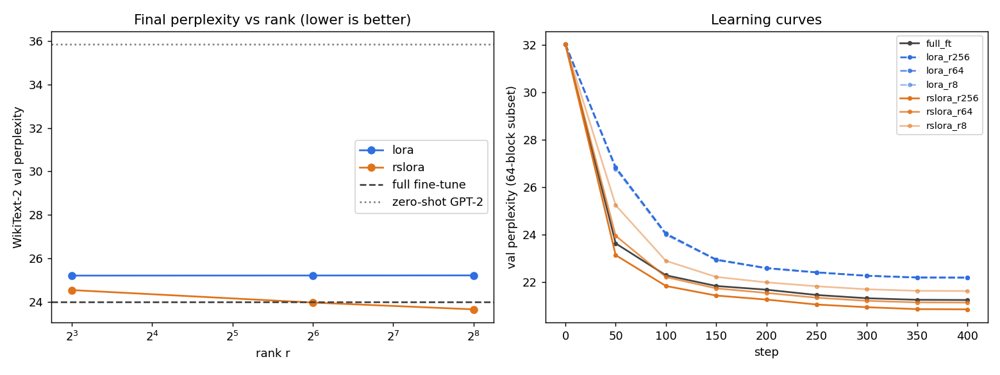
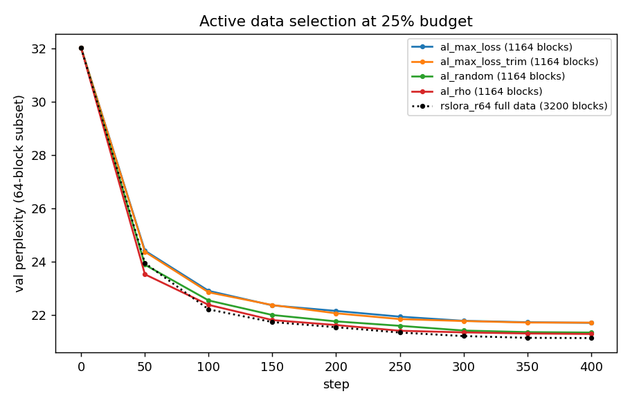
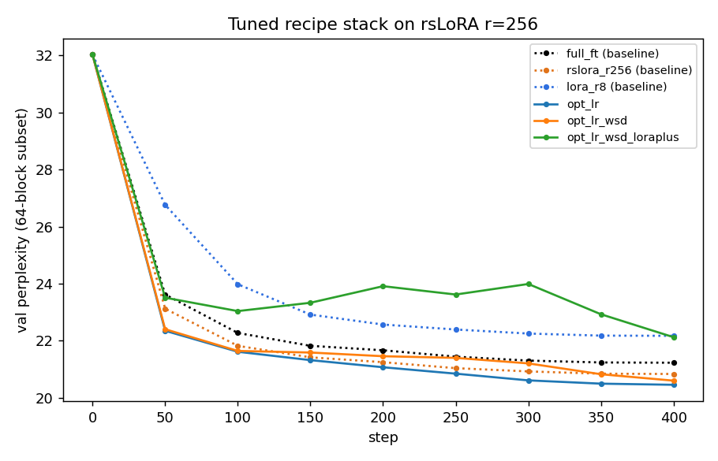

# LoRA / rsLoRA / Active Learning on a T4

Zero-shot GPT-2 val PPL: **35.84**

Steps-to-target = first step whose quick-eval PPL matches the final quick-eval PPL of `lora_r8`.

| run | method | r | trainable params | unique blocks | final val PPL | steps to target | train time (s) | tok/s | peak mem (GB) |
|---|---|---|---|---|---|---|---|---|---|
| opt_lr | rslora | 256 | 37,748,736 | 3200 | 23.28 | 100 | 187 | 8748 | 9.29 |
| opt_lr_wsd | rslora | 256 | 37,748,736 | 3200 | 23.58 | 100 | 187 | 8761 | 9.29 |
| rslora_r256 | rslora | 256 | 37,748,736 | 3200 | 23.65 | 100 | 183 | 8930 | 9.27 |
| rslora_r64 | rslora | 64 | 9,437,184 | 3200 | 23.96 | 150 | 169 | 9670 | 8.87 |
| full_ft | full | 0 | 124,439,808 | 3200 | 24.00 | 150 | 179 | 9140 | 10.00 |
| al_rho | rslora | 64 | 9,437,184 | 1164 | 24.19 | 150 | 299 | 9562 | 8.87 |
| al_random | rslora | 64 | 9,437,184 | 1164 | 24.29 | 150 | 169 | 9702 | 8.87 |
| al_max_loss_trim | rslora | 64 | 9,437,184 | 1164 | 24.42 | 200 | 293 | 9702 | 8.87 |
| al_max_loss | rslora | 64 | 9,437,184 | 1164 | 24.43 | 200 | 293 | 9698 | 8.87 |
| rslora_r8 | rslora | 8 | 1,179,648 | 3200 | 24.54 | 200 | 167 | 9824 | 8.76 |
| lora_r8 | lora | 8 | 1,179,648 | 3200 | 25.20 | 400 | 167 | 9826 | 8.76 |
| lora_r64 | lora | 64 | 9,437,184 | 3200 | 25.21 | None | 169 | 9700 | 8.87 |
| lora_r256 | lora | 256 | 37,748,736 | 3200 | 25.21 | None | 183 | 8935 | 9.27 |
| opt_lr_wsd_loraplus | rslora | 256 | 37,748,736 | 3200 | 25.43 | 400 | 187 | 8767 | 9.29 |

